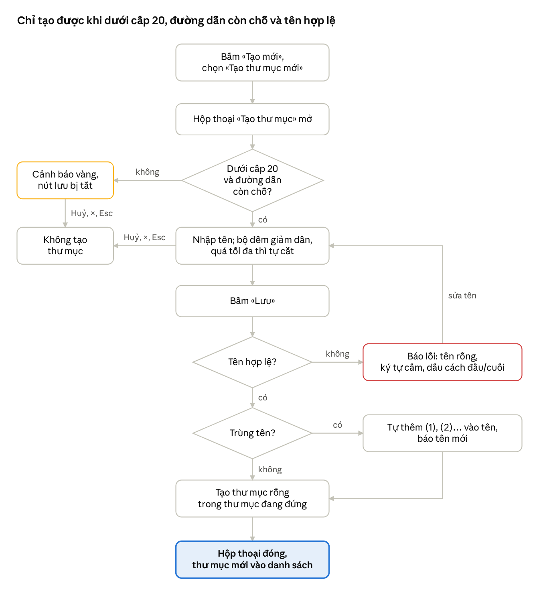

# Tạo thư mục mới — nghiệp vụ, câu hỏi, SRS / US / UC

02/10/2026 · Hanna

> Bản xuất từ Claude Docs ngày 02/10/2026. Bản gốc: https://claude.ai/code/artifact/c633e612-f0fa-46bf-91a2-e3071a17ffbc. Ở bản gốc, cột Trạng thái là danh sách chọn; ở bản này là chữ. Sơ đồ luồng là ảnh tao-thu-muc_so-do-luong.png cùng thư mục.

Phần tạo thư mục mới đã đủ để viết TC: Hanna trả lời cả 12 câu ngày 02/10/2026, kèm 3 ảnh. Còn 3 chi tiết nhỏ (C1, C4, C5) đang theo mặc định; cần nhất là con số giới hạn tổng độ dài đường dẫn.

## Phạm vi và nguồn

Tài liệu chỉ bàn việc tạo thư mục mới bằng tay: từ nút «Tạo mới» tới khi thư mục mới hiện trong danh sách. Đổi tên, di chuyển, xoá và tải lên chỉ được nhắc khi ảnh hưởng tới việc tạo.

| Ưu tiên | Nguồn | Lấy gì |
| --- | --- | --- |
| 1 | Chốt và trả lời Q1–Q12 của Hanna ngày 02/10/2026, kèm 3 ảnh: ảnh 1 là màn gốc có chú thích cách đếm cấp; ảnh 2 và 3 chụp hệ thống đang chạy ("Quản lý thư viện") | Mọi quy tắc của phần này: độ dài và cách đếm ký tự, số cấp, phạm vi, trùng tên, ký tự cấm, dấu cách, giới hạn đường dẫn, câu thông báo |
| 2 | Mockup bản 5 (Quan\_ly\_tai\_lieu\_mockup5.pdf): tr.2 menu «Tạo mới», tr.7 hộp thoại «Tạo thư mục», tr.9 thư mục trống, tr.1 và tr.5 thư mục hệ thống, tr.6 bộ lọc phạm vi, tr.10 danh sách trong thư mục | Nhãn, bố cục hộp thoại, bộ đếm ký tự, các cột của danh sách |
| 3 | Bộ TC FEEC cũ (FEEC\_PM\_IT\_Test\_Case\_Document\_v3.xlsx, sheet Document): TC\_021, TC\_022, TC\_079 → TC\_083, TC\_143; đối chiếu thêm TC\_055, TC\_144, TC\_146, TC\_150 | Câu báo vượt cấp tiếng Nhật; các chỗ cần sửa. Bộ này đã lỗi thời |

Nguồn sau chỉ dùng ở chỗ không trái nguồn trước. Chỗ không nguồn nào nói thì thành câu hỏi, kèm đề xuất mặc định.

Ký hiệu: «…» là chữ trên giao diện theo mockup; "…" là dữ liệu nhập, chữ trích từ bộ TC cũ hoặc ảnh hệ thống, và câu thông báo.

## Nghiệp vụ cần hiểu

Có 16 điểm nghiệp vụ: 12 điểm đã đủ; 3 điểm còn một chi tiết nhỏ (C1, C4, C5) đang theo mặc định; riêng cách đếm emoji chưa rõ nên tạm không test.

| Điểm nghiệp vụ | Quy tắc đã biết | Nguồn | Còn mở |
| --- | --- | --- | --- |
| Lối vào | «Tạo mới» mở menu 3 mục: «Tạo thư mục mới», «Tải tệp lên», «Tải thư mục lên» | tr.2 | Không |
| Hộp thoại | Tiêu đề «Tạo thư mục»; nhãn «Tên thư mục \*»; ô rỗng có placeholder «Nhập tên thư mục», đang focus; bộ đếm «Còn 255 ký tự (tối đa 255)»; nút «Huỷ», «Lưu», «×» | tr.7 | Không |
| Nơi tạo | Thư mục mới nằm trong thư mục đang mở. Dòng vị trí hiện cả đường dẫn như breadcrumb ở ảnh 2, bấm được vào từng thư mục | tr.7; Q10, ảnh 2 | Không |
| Phạm vi | Có 2 phạm vi «Tài liệu dự án» và «Thư mục công trình cũ». Tạo được thư mục bên trong «Thư mục công trình cũ»; bản thân nó không xoá, đổi tên, di chuyển được. Thư mục chỉ đổi tên, di chuyển trong phạm vi của nó | tr.1, tr.5, tr.6; chốt 02/10; Q5 | Không |
| Số cấp | Tối đa 20 cấp. Thư mục ở gốc «Tài liệu dự án» (vd «Quản lý rủi ro») là cấp 1, bên trong thêm được 19 cấp. «Thư mục công trình cũ» không tính là cấp, bên trong được đủ 20 cấp. Ở cấp 20, mở hộp thoại là thấy cảnh báo vàng, nút lưu bị tắt | Chốt 02/10; Q1, ảnh 1 | Không |
| Tên bắt buộc | Để trống rồi bấm «Lưu» thì báo "Vui lòng nhập tên tệp." | Q3 | Tên chỉ toàn dấu cách (C4) |
| Dấu cách | Tên không được bắt đầu hoặc kết thúc bằng dấu cách; hệ thống không tự cắt mà báo lỗi | Q7 | Không |
| Độ dài tên | Tối đa 255 ký tự; Full-width và Half-width đều tính 1. Gõ hoặc dán quá thì tự cắt, không báo lỗi | Chốt 02/10; Q2 | Không |
| Cách đếm ký tự | Mỗi dấu tiếng Việt tính thêm 1: "Tại sảo" tính là 9 ký tự | Q8 | Emoji chưa rõ, tạm không test |
| Giới hạn đường dẫn | Có giới hạn tổng độ dài đường dẫn. Hết chỗ thì hộp thoại hiện cảnh báo vàng, bộ đếm "Còn 0 ký tự (tối đa 0 ký tự)", nút lưu bị tắt | Q12, ảnh 3 | Giới hạn bao nhiêu, cảnh báo hiện khi nào (C1) |
| Ký tự cấm | Cấm `\ / : * ? " < >`; báo "Tên tệp chứa các ký tự không được phép sử dụng." | Q7 | Dấu gạch đứng, tên chỉ gồm dấu chấm (C5) |
| Trùng tên | So với mọi thư mục và tệp trong cùng thư mục cha, kể cả mục đã xoá vào «Thùng rác» và tên chỉ khác chữ hoa/thường hoặc Full-width/Half-width. Trùng thì tự thêm " (1)", " (2)"… và báo tên mới | TC\_143; Q4 | Không |
| Kết quả sau khi lưu | Hộp thoại đóng; báo "Tôi đã tạo một thư mục."; thư mục mới hiện trong danh sách, có «Người cập nhật cuối» và «Cập nhật lần cuối» | Q9; tr.10 | Không |
| Đóng hộp thoại | «Huỷ», «×» và Esc đều đóng; không hỏi lại khi đang nhập | tr.7; Q11 | Không |
| Lỗi khi lưu | Báo "Không thể tạo thư mục." | Q12 | Không |
| Quyền | Ngoài phạm vi: màn này tính là có toàn quyền | Q6 | Không |

## Câu hỏi và trả lời

Hanna đã trả lời đủ 12 câu ngày 02/10/2026. Sau đó đã chốt thêm C2, C3; còn C1, C4, C5 đang theo mặc định, trả lời khác thì comment vào dòng đó.

| # | Câu hỏi | Trả lời ngày 02/10 | Trạng thái |
| --- | --- | --- | --- |
| Q1 | Đếm cấp thế nào? «Thư mục công trình cũ» tính là cấp mấy? | Thư mục ở gốc (vd «Quản lý rủi ro», «Xem xét chi phí») đã là cấp 1, bên trong tạo thêm được 19 cấp. «Thư mục công trình cũ» chưa tính là cấp, bên trong tạo được đủ 20 cấp (ảnh 1) | Đã trả lời |
| Q2 | Gõ hoặc dán quá 255 ký tự thì sao? | Tự cắt, không hiện thông báo lỗi | Đã trả lời |
| Q3 | Để trống rồi bấm «Lưu» thì sao? | Báo lỗi "Vui lòng nhập tên tệp." | Đã trả lời |
| Q4 | Trùng tên thì đặt số thế nào, so với những gì? | So sánh tất cả, cả thư mục lẫn tệp. Trùng thì tự thêm (1), (2)… và hiện thông báo tên mới (câu đầy đủ ở MSG-05). Tải lên và di chuyển cũng bắt trùng như vậy | Đã trả lời |
| Q5 | Có tạo được bên trong «Thư mục công trình cũ» không? | Được, như trả lời Q1 | Đã trả lời |
| Q6 | Vai trò nào được tạo thư mục? | Tạm bỏ qua: màn này tính là có toàn quyền; thực tế có nhiều logic phân quyền | Đã trả lời |
| Q7 | Có cấm ký tự nào không? | Cấm `\ / : * ? " < >`, báo "Tên tệp chứa các ký tự không được phép sử dụng." Cấm dấu cách ở cuối tên, báo "Tên không được bắt đầu hoặc kết thúc bằng dấu cách." | Đã trả lời |
| Q8 | Chữ có dấu và emoji tính mấy ký tự? | "Tại sảo" (không có dấu cách cuối) tính là 9 ký tự, tức mỗi dấu tính thêm 1 | Đã trả lời |
| Q9 | Lưu xong thì sao? | Báo "Tôi đã tạo một thư mục."; danh sách hiện «Người cập nhật cuối» và «Cập nhật lần cuối» | Đã trả lời |
| Q10 | Dòng vị trí tạo hiện gì? | Hiện như ảnh 2: cả đường dẫn, bấm được vào từng thư mục | Đã trả lời |
| Q11 | Esc, bấm ra ngoài, có hỏi lại không? | Esc đóng hộp thoại; không hỏi lại khi đang nhập | Đã trả lời |
| Q12 | Lưu bị lỗi thì sao? | Báo "Không thể tạo thư mục." Thêm trường hợp ảnh 3: đường dẫn hết chỗ thì hộp thoại hiện cảnh báo vàng, tối đa 0 ký tự | Đã trả lời |

### Chi tiết thêm C1–C5

| # | Chi tiết | Trả lời hoặc mặc định | Trạng thái |
| --- | --- | --- | --- |
| C1 | Giới hạn tổng độ dài đường dẫn là bao nhiêu ký tự, tính những phần nào? Cảnh báo vàng chỉ hiện khi còn 0, hay cả khi còn ít hơn 255? | Chưa có số. Mặc định: dùng số "tối đa" hộp thoại đang hiện, không dùng con số cố định; cảnh báo hiện mỗi khi tối đa nhỏ hơn 255 | Chờ trả lời |
| C2 | "So sánh tất cả" có gồm tên chỉ khác chữ hoa, chữ thường hoặc khác Full-width, Half-width không (vd "abc" và "ABC")? | Trả lời 02/10: có, các tên đó vẫn tính là trùng | Đã trả lời |
| C3 | Ở thư mục cấp 20: báo lỗi khi bấm «Lưu», hay hiện cảnh báo ngay khi mở hộp thoại? | Trả lời 02/10: cảnh báo vàng ngay khi mở hộp thoại, nút lưu bị tắt, giống ảnh 3 | Đã trả lời |
| C4 | Tên chỉ toàn dấu cách báo câu nào? | Mặc định: "Tên không được bắt đầu hoặc kết thúc bằng dấu cách." | Chờ trả lời |
| C5 | Dấu gạch đứng và tên chỉ gồm dấu chấm ("." hoặc "..") có bị cấm không? | Mặc định: không cấm, chỉ cấm đúng 8 ký tự ở Q7 | Chờ trả lời |

Liên quan nhưng thuộc phần khác, hỏi khi làm tới phần đó:

- Giới hạn 20 cấp có áp cho «Tải thư mục lên» không?
- Đổi tên trùng thì báo lỗi (TC\_144), còn tạo, tải lên và di chuyển trùng thì tự thêm số: có cố ý không?
- Di chuyển sang phạm vi kia bị chặn bằng cách nào: ẩn thư mục đích hay báo lỗi?

## SRS: yêu cầu chức năng, quy tắc, thông báo

Phần tạo thư mục có 9 yêu cầu chức năng, 10 quy tắc nghiệp vụ và 8 thông báo. Chỗ còn theo mặc định ghi C1–C5.

### Yêu cầu chức năng (FR)

- **FR-01** — Bấm «Tạo mới» mở menu 3 mục: «Tạo thư mục mới», «Tải tệp lên», «Tải thư mục lên» (tr.2).
- **FR-02** — Chọn «Tạo thư mục mới» mở hộp thoại «Tạo thư mục» gồm: dòng «Thư mục mới sẽ được tạo tại: …» hiện cả đường dẫn tới thư mục đang đứng như breadcrumb ở ảnh 2, bấm được vào từng thư mục (Q10); nhãn «Tên thư mục \*»; ô rỗng có placeholder «Nhập tên thư mục», đang focus; bộ đếm «Còn N ký tự (tối đa M)»; nút «Huỷ», «Lưu», «×» (tr.7).
- **FR-03** — Bộ đếm cập nhật mỗi lần nhập hoặc xoá: N = M trừ số ký tự đang có. M là 255, hoặc nhỏ hơn khi đường dẫn gần hết chỗ (BR-03, BR-08). Gõ hoặc dán quá M thì ô tự cắt, không báo lỗi.
- **FR-04** — Bấm «Lưu» thì hệ thống kiểm tên theo BR-01, BR-02, BR-04. Sai thì hiện câu báo tương ứng, giữ hộp thoại và tên đã nhập.
- **FR-05** — Hợp lệ thì hệ thống tạo một thư mục rỗng trong thư mục đang đứng, cùng phạm vi (BR-09), đóng hộp thoại và hiện MSG-06. Trùng tên thì tự thêm số (BR-06) và hiện MSG-05.
- **FR-06** — Danh sách hiện thư mục mới: «Định dạng» và «Dung lượng» là «—»; «Người cập nhật cuối» là người tạo; «Cập nhật lần cuối» là lúc tạo (tr.10; Q9). Ngày giờ dạng DD/MM/YYYY HH:mm, thư mục mới xếp theo cách sắp xếp đang chọn, người dùng ở lại thư mục đang đứng: theo đề xuất cũ, vì Q9 chưa nói tới.
- **FR-07** — Mở thư mục vừa tạo thì thấy «Bấm + Tạo mới để tải tệp hoặc tạo thư mục con.» (tr.9).
- **FR-08** — «Huỷ», «×» hoặc Esc đóng hộp thoại ngay, không hỏi lại, không tạo thư mục (Q11). Bấm ra ngoài không đóng, mở lại thì ô rỗng: theo đề xuất cũ.
- **FR-09** — Mở hộp thoại ở thư mục cấp 20 (BR-07), hoặc khi đường dẫn đã hết chỗ (BR-08): hộp thoại vẫn mở nhưng hiện cảnh báo vàng ở trên cùng (MSG-01 hoặc MSG-08) và nút lưu bị tắt (C3, ảnh 3). Với đường dẫn hết chỗ, bộ đếm hiện "Còn 0 ký tự (tối đa 0 ký tự)" và không nhập được.

### Quy tắc nghiệp vụ (BR)

| ID | Quy tắc | Trạng thái | Nguồn |
| --- | --- | --- | --- |
| BR-01 | Tên thư mục là bắt buộc | Đã chốt. Tên chỉ toàn dấu cách: C4 | Q3; tr.7 |
| BR-02 | Tên không được bắt đầu hoặc kết thúc bằng dấu cách; hệ thống không tự cắt dấu cách mà báo lỗi | Đã chốt | Q7 |
| BR-03 | Tên dài tối đa 255 ký tự. Full-width và Half-width đều tính 1; mỗi dấu tiếng Việt tính thêm 1 ("Tại sảo" là 9) | Đã chốt. Emoji: chưa rõ, tạm không test | Chốt 02/10; Q2, Q8 |
| BR-04 | Tên không được chứa `\ / : * ? " < >` | Đã chốt. Dấu gạch đứng, tên chỉ gồm dấu chấm: C5 | Q7 |
| BR-05 | Tên được chứa ký tự Full-width và giữ nguyên như đã nhập | Theo bộ TC | TC\_083 |
| BR-06 | Trùng tên với một thư mục hoặc tệp trong cùng thư mục cha, kể cả mục đã xoá vào «Thùng rác» và tên chỉ khác chữ hoa/thường hoặc Full-width/Half-width, thì vẫn tạo; tên mới tự thêm " (1)", " (2)"… Muốn dùng lại tên gốc thì xoá vĩnh viễn mục đó khỏi «Thùng rác» | Đã chốt | TC\_143; Q4 |
| BR-07 | Thư mục lồng nhau tối đa 20 cấp. Thư mục ở gốc «Tài liệu dự án» là cấp 1, bên trong thêm được 19 cấp. «Thư mục công trình cũ» không tính là cấp, bên trong được đủ 20 cấp. Đang ở cấp 20 thì mở hộp thoại là thấy cảnh báo MSG-01, nút lưu bị tắt | Đã chốt | Chốt 02/10; Q1, ảnh 1 |
| BR-08 | Tổng độ dài đường dẫn có giới hạn: số ký tự tối đa của tên mới giảm theo đường dẫn; hết chỗ thì tối đa là 0 và không lưu được | Đã chốt. Con số và cách tính: C1 | Q12, ảnh 3 |
| BR-09 | Thư mục mới thuộc phạm vi của nơi tạo, «Tài liệu dự án» hoặc «Thư mục công trình cũ»; về sau chỉ đổi tên, di chuyển trong phạm vi đó | Đã chốt | Chốt 02/10; Q5 |
| BR-10 | «Thư mục công trình cũ» là thư mục hệ thống: không xoá, đổi tên, di chuyển được, nhưng tạo được thư mục bên trong | Đã chốt | tr.1, tr.5; Q5 |

Phân quyền nằm ngoài phạm vi: màn này tính là có toàn quyền (Q6).

### Thông báo

Câu "Tên thư mục quá dài (tối đa 255 ký tự)." của TC\_082 đã bỏ, vì gõ hay dán quá đều tự cắt (Q2). Các câu dưới đây là tiếng Việt dịch tạm, dùng luôn cho TC.

| ID | Khi nào | Câu thông báo | Nguồn |
| --- | --- | --- | --- |
| MSG-01 | Mở hộp thoại ở thư mục cấp 20; hiện ở đầu hộp thoại | Không thể tạo thư mục con vì số cấp thư mục đã đạt giới hạn (20 cấp). | TC\_081: フォルダの階層が上限（10階層）に達しているため、サブフォルダを作成できません。 (dịch tạm, đổi 10 thành 20) |
| MSG-02 | Bấm «Lưu» khi tên rỗng | Vui lòng nhập tên tệp. | Q3; trùng câu của phần Đổi tên ở TC\_055 |
| MSG-03 | Tên có dấu cách ở đầu hoặc cuối | Tên không được bắt đầu hoặc kết thúc bằng dấu cách. | Q7 |
| MSG-04 | Tên có ký tự bị cấm | Tên tệp chứa các ký tự không được phép sử dụng. | Q7 |
| MSG-05 | Trùng tên, hệ thống đã tự thêm số | Vì chúng có cùng tên, tôi đã tạo một thư mục mới có tên "\[tên mới\]" thay vì "\[tên đã nhập\]". Các mục trong Thùng rác cũng sẽ giữ nguyên tên của chúng. Để sử dụng tên gốc, vui lòng xóa hoàn toàn mục đó khỏi Thùng rác. | Q4; ví dụ của Hanna: "Thư mục mới (2)" thay vì "Thư mục mới" |
| MSG-06 | Tạo thành công | Tôi đã tạo một thư mục. | Q9 |
| MSG-07 | Lưu bị lỗi | Không thể tạo thư mục. | Q12 |
| MSG-08 | Đường dẫn hết chỗ, hiện ở đầu hộp thoại | \*Do giới hạn đường dẫn tổng thể ở cấp độ này, số ký tự tối đa là 0. Vui lòng chọn cấp độ cao hơn hoặc rút ngắn tên thư mục cha. | Ảnh 3; số 0 đổi theo số tối đa (C1) |

## User story và tiêu chí chấp nhận

**US-01** — Là thành viên dự án có toàn quyền ở màn Quản lý tài liệu, tôi muốn tạo thư mục mới ngay tại thư mục đang mở, để xếp tài liệu theo cấu trúc của dự án.

| AC | Cho trước (Given) | Khi (When) | Thì (Then) | Căn cứ |
| --- | --- | --- | --- | --- |
| AC-01 | Đang ở danh sách gốc hoặc trong một thư mục | Bấm «Tạo mới» | Menu hiện 3 mục: «Tạo thư mục mới», «Tải tệp lên», «Tải thư mục lên» | FR-01 |
| AC-02 | Menu «Tạo mới» đang mở | Chọn «Tạo thư mục mới» | Hộp thoại «Tạo thư mục» mở; dòng vị trí hiện cả đường dẫn tới thư mục đang đứng; ô tên rỗng, đang focus; bộ đếm «Còn 255 ký tự (tối đa 255)» | FR-02 |
| AC-03 | Hộp thoại đang mở | Nhập "ＮＲＴ０７８" (6 ký tự Full-width) | Bộ đếm «Còn 249 ký tự (tối đa 255)» | FR-03, BR-03 |
| AC-04 | Hộp thoại đang mở | Nhập "Tại sảo" | Bộ đếm «Còn 246 ký tự (tối đa 255)», vì "Tại sảo" tính là 9 ký tự | FR-03, BR-03 |
| AC-05 | Hộp thoại đang mở | Gõ tới ký tự thứ 256, hoặc dán một chuỗi 300 ký tự | Ô chỉ giữ 255 ký tự đầu; bộ đếm «Còn 0 ký tự (tối đa 255)»; không có câu báo lỗi | FR-03, BR-03 |
| AC-06 | Thư mục đang đứng chưa có mục nào tên "Hồ sơ thiết kế" | Nhập "Hồ sơ thiết kế", bấm «Lưu» | Hộp thoại đóng; hiện "Tôi đã tạo một thư mục."; danh sách có thư mục "Hồ sơ thiết kế": «Định dạng» và «Dung lượng» là «—», «Người cập nhật cuối» là người tạo, «Cập nhật lần cuối» là lúc tạo | FR-05, FR-06, MSG-06 |
| AC-07 | Hộp thoại đang mở | Nhập tên đúng 255 ký tự (toàn Full-width, toàn Half-width, hoặc trộn), bấm «Lưu» | Tạo được; tên giữ đủ 255 ký tự, ký tự Full-width không bị đổi sang Half-width | BR-03, BR-05 |
| AC-08 | Thư mục đang đứng đã có thư mục "Báo cáo" | Tạo thư mục tên "Báo cáo", rồi tạo thêm lần nữa | Lần 1 ra "Báo cáo (1)", lần 2 ra "Báo cáo (2)"; mỗi lần hiện MSG-05 với tên mới; thư mục "Báo cáo" cũ giữ nguyên | BR-06, MSG-05 |
| AC-09 | Thư mục đang đứng có một tệp tên "Báo cáo" | Tạo thư mục tên "Báo cáo" | Thư mục mới tên "Báo cáo (1)"; hiện MSG-05 | BR-06 |
| AC-10 | Thư mục "Báo cáo" của thư mục đang đứng đã bị xoá, đang nằm trong «Thùng rác» | Tạo thư mục tên "Báo cáo"; sau đó xoá vĩnh viễn mục kia khỏi «Thùng rác» rồi tạo lại | Lần đầu ra "Báo cáo (1)" và hiện MSG-05; sau khi xoá vĩnh viễn thì tạo được đúng tên "Báo cáo" | BR-06 |
| AC-11 | Thư mục đang đứng chỉ có thư mục "abc" | Tạo thư mục tên "ABC" (hoặc "ａｂｃ") | Tính là trùng, ra "ABC (1)" (hoặc "ａｂｃ (1)") | BR-06 |
| AC-12 | Đang đứng ở thư mục cấp 19 trong «Tài liệu dự án» (cấp 1 là thư mục ở gốc) | Tạo thư mục con tên hợp lệ | Tạo được; thư mục mới ở cấp 20 | BR-07 |
| AC-13 | Đang đứng ngay trong «Thư mục công trình cũ» | Tạo thư mục tên hợp lệ | Tạo được; thư mục mới là cấp 1, thuộc phạm vi «Thư mục công trình cũ» | BR-07, BR-09, BR-10 |
| AC-14 | Đang đứng ở thư mục cấp 19 bên trong «Thư mục công trình cũ» | Tạo thư mục con tên hợp lệ | Tạo được; thư mục mới ở cấp 20 | BR-07 |
| AC-15 | Ô tên rỗng | Bấm «Lưu» | Hiện "Vui lòng nhập tên tệp."; hộp thoại vẫn mở; không tạo thư mục | BR-01, MSG-02 |
| AC-16 | Hộp thoại đang mở | Nhập "Báo cáo" có thêm dấu cách ở đầu, hoặc ở cuối, rồi bấm «Lưu» | Hiện "Tên không được bắt đầu hoặc kết thúc bằng dấu cách."; không tạo thư mục | BR-02, MSG-03 |
| AC-17 | Ô tên chỉ có dấu cách | Bấm «Lưu» | Theo mặc định C4: hiện "Tên không được bắt đầu hoặc kết thúc bằng dấu cách."; không tạo thư mục | BR-01, BR-02, C4 |
| AC-18 | Hộp thoại đang mở | Nhập tên có một ký tự trong `\ / : * ? " < >`, vd "Bản vẽ/2026", rồi bấm «Lưu» | Hiện "Tên tệp chứa các ký tự không được phép sử dụng."; không tạo thư mục | BR-04, MSG-04 |
| AC-19 | Đang đứng ở thư mục cấp 20, trong «Tài liệu dự án» hoặc trong «Thư mục công trình cũ» | Chọn «Tạo thư mục mới» | Hộp thoại hiện cảnh báo vàng "Không thể tạo thư mục con vì số cấp thư mục đã đạt giới hạn (20 cấp)."; nút lưu bị tắt; không tạo được thư mục | BR-07, FR-09, MSG-01 |
| AC-20 | Đường dẫn tới thư mục đang đứng đã hết chỗ, như ảnh 3 | Chọn «Tạo thư mục mới» | Hộp thoại hiện cảnh báo vàng MSG-08; bộ đếm "Còn 0 ký tự (tối đa 0 ký tự)"; không nhập được; nút lưu bị tắt | FR-09, BR-08, C1 |
| AC-21 | Hộp thoại đang mở, đã nhập tên | Bấm «Huỷ», bấm «×», hoặc nhấn Esc | Hộp thoại đóng ngay, không hỏi lại; không có thư mục mới | FR-08 |
| AC-22 | Vừa tạo thư mục "Hồ sơ thiết kế" | Mở thư mục đó | Thấy «Bấm + Tạo mới để tải tệp hoặc tạo thư mục con.» | FR-07 |
| AC-23 | Lưu bị lỗi, vd mất mạng | Bấm «Lưu» | Hiện "Không thể tạo thư mục."; không tạo thư mục | MSG-07 |

AC có ghi C1, C4 hoặc C5 ở cột Căn cứ đang theo mặc định ở mục Câu hỏi và trả lời; trả lời khác thì sửa AC đó trước khi viết TC.

## Use case UC-DOC-007: Tạo thư mục mới

Người dùng tạo một thư mục rỗng tại thư mục đang mở; hệ thống kiểm đường dẫn, tên, số cấp và trùng tên trước khi lưu.

Lỗi tên quay lại ô nhập; ở cấp 20 hoặc khi đường dẫn hết chỗ, hộp thoại cảnh báo ngay và không lưu được; trùng tên vẫn tạo nhưng thêm số. Lỗi khi lưu (E6) không vẽ.

| Mục | Nội dung |
| --- | --- |
| Tác nhân | Thành viên dự án, tính là có toàn quyền (Q6) |
| Tiền điều kiện | Đã đăng nhập; đang ở màn Quản lý tài liệu của dự án, tại gốc hoặc trong một thư mục |
| Kích hoạt | Bấm «Tạo mới», chọn «Tạo thư mục mới» |
| Hậu điều kiện khi thành công | Có thêm một thư mục rỗng trong thư mục đang đứng, cùng phạm vi, tên không trùng mục nào khác trong thư mục cha, kể cả mục trong «Thùng rác» |
| Hậu điều kiện khi huỷ hoặc lỗi | Không có thư mục nào được tạo; danh sách giữ nguyên |
| Quy tắc áp dụng | BR-01 → BR-10 |

**Luồng chính**

1. Người dùng bấm «Tạo mới».
2. Hệ thống hiện menu 3 mục (FR-01).
3. Người dùng chọn «Tạo thư mục mới».
4. Hệ thống mở hộp thoại «Tạo thư mục» và kiểm số cấp cùng phần đường dẫn còn lại (FR-02, BR-07, BR-08).
5. Người dùng nhập tên; hệ thống cập nhật bộ đếm và tự cắt phần quá tối đa (FR-03, BR-03).
6. Người dùng bấm «Lưu».
7. Hệ thống kiểm tên (BR-01, BR-02, BR-04).
8. Hệ thống kiểm trùng tên trong thư mục cha, kể cả «Thùng rác» (BR-06).
9. Hệ thống tạo thư mục trong thư mục đang đứng, cùng phạm vi (BR-09).
10. Hệ thống đóng hộp thoại, hiện MSG-06 và thư mục mới trong danh sách (FR-05, FR-06).

**Luồng thay thế**

- **A1** (bước 8): tên trùng → tên mới tự thêm " (1)", " (2)"… (BR-06); ở bước 10 hiện MSG-05 thay cho MSG-06 (giả định).
- **A2** (bước 4–6): bấm «Huỷ», «×» hoặc nhấn Esc → hộp thoại đóng ngay, không hỏi lại, không tạo thư mục; kết thúc (FR-08).
- **A3** (bước 1): đang đứng trong «Thư mục công trình cũ» → như luồng chính; thư mục mới thuộc phạm vi đó, cấp tính từ bên trong «Thư mục công trình cũ» (BR-07, BR-09).

**Ngoại lệ**

- **E1** (bước 4): đường dẫn hết chỗ → hộp thoại hiện MSG-08, tối đa 0 ký tự, nút lưu bị tắt; người dùng chỉ đóng được hộp thoại (FR-09, C1).
- **E2** (bước 7): tên rỗng → MSG-02; quay lại bước 5.
- **E3** (bước 7): tên có dấu cách ở đầu hoặc cuối → MSG-03; quay lại bước 5.
- **E4** (bước 7): tên có ký tự bị cấm → MSG-04; quay lại bước 5.
- **E5** (bước 4): thư mục đang đứng đã ở cấp 20 → hộp thoại hiện cảnh báo vàng MSG-01, nút lưu bị tắt; người dùng chỉ đóng được hộp thoại (FR-09).
- **E6** (bước 9): mất mạng hoặc lỗi máy chủ → MSG-07; giữ hộp thoại và tên đã nhập, quay lại bước 6.

## Ghi chú cho bước viết TC

Cả 8 TC cũ của phần tạo thư mục đều cần sửa, và 14 AC chưa có TC nào.

| TC cũ | Vấn đề | Sửa thành |
| --- | --- | --- |
| TC\_021 | Kết quả chỉ có 2 mục, thiếu «Tải thư mục lên» | Đủ 3 mục (AC-01) |
| TC\_022 | Kết quả "Hiển thị màn hình: PM0035" không kiểm được bằng mắt | Liệt kê phần tử của hộp thoại (AC-02) |
| TC\_079 | Tiêu đề "dưới 255 ký tự" nhưng dữ liệu "Folder 1" chỉ 8 ký tự; một bước gộp 3 thao tác | Tách: tên thường (AC-06) và tên đúng 255 ký tự (AC-07) |
| TC\_080 | Tạo tới cấp 10 (lỗi thời); có hai bước cùng đánh số 3 | Tạo tới cấp 20, tách hai phạm vi (AC-12, AC-14) |
| TC\_081 | Thử cấp 11; thông báo còn ghi 10階層 | Ở cấp 20, mở hộp thoại thấy cảnh báo MSG-01, nút lưu bị tắt; thử ở cả hai phạm vi (AC-19) |
| TC\_082 | "Hệ thống tự cắt ký tự và báo lỗi" | Bỏ phần báo lỗi: gõ hay dán quá đều tự cắt, không báo (AC-05) |
| TC\_083 | Kết quả "Cho phép tạo bình thường" mơ hồ | Thư mục "ＮＲＴ０７８" hiện đúng tên, không bị đổi sang Half-width (AC-07, BR-05) |
| TC\_143 | Kết quả "Hiển thị thêm Số thứ tự" chưa có tên cụ thể | Ghi tên "A (1)" và câu MSG-05 (AC-08) |

- **AC chưa có TC:** AC-03, AC-04 (bộ đếm), AC-09 → AC-11 (trùng với tệp, với mục trong «Thùng rác», khác hoa thường), AC-13 (tạo trong «Thư mục công trình cũ»), AC-15 → AC-18 (tên rỗng, dấu cách, ký tự cấm), AC-20 (đường dẫn hết chỗ), AC-21 (huỷ, Esc), AC-22 (thư mục trống), AC-23 (lỗi khi lưu).
- **Dữ liệu cấp:** tiền điều kiện của 8 TC cũ đang để trống. Ca cấp 20 cần chuỗi 19 và 20 cấp có sẵn ở cả hai phạm vi. Đặt tên ngắn (vd "1" → "20") để không chạm giới hạn đường dẫn trước khi tới cấp 20. Ca đường dẫn hết chỗ thì ngược lại: dùng tên dài 255 ký tự như ảnh 2.
- **Dữ liệu đếm ký tự:** "Tại sảo" là 9 cho thấy hệ thống đếm theo dạng tách dấu (suy ra từ ví dụ). Nên thử thêm "Việt" (6 ký tự), "đ" (1 ký tự), chữ Nhật có dấu như "デ" (2 ký tự), và ca gõ chữ có dấu đúng ở ký tự thứ 255 để xem hệ thống có cắt mất dấu không.
- **Nhãn:** ảnh 2 và 3 ghi khác mockup: "Tạo một thư mục", "Nhập tên tệp", "Hủy bỏ", "giữ", "Còn 0 ký tự (tối đa 0 ký tự)". TC tạm theo nhãn mockup, như cách Hanna trả lời («Lưu»).
- **Thứ tự:** hiển thị → nhập liệu → tạo thành công (gồm trùng tên, cấp 20) → tạo không thành công → huỷ. TC\_143 chuyển về cùng khu vực tạo thư mục.
- **Ngày giờ:** TC\_150 ghi "YYYY-MM-DD HH:MM", mockup ghi «30/09/2026 15:02»; tạm theo mockup.
- **Dữ liệu trong file:** kết quả Round 2 của cả 8 TC nằm lệch một cột (ở cột Remark của Round 1). Nhiều ô chữ có dấu ở dạng tổ hợp, nên lọc và tìm có thể trượt; gõ lại khi sửa TC.

Thay cho TC, đã lập file phân tích case cha con Tao\_thu\_muc\_phan\_tich\_case\_cha\_con.xlsx ngày 02/10: 11 case cha, 74 case con, dựa trên AC-01 → AC-23.
